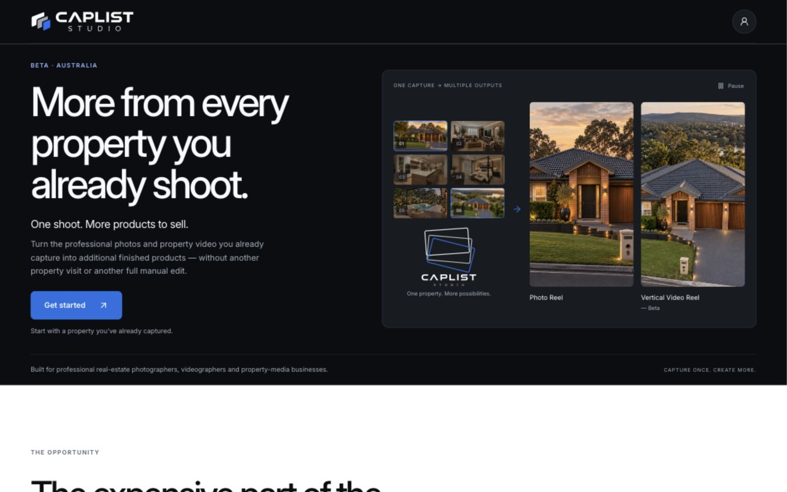
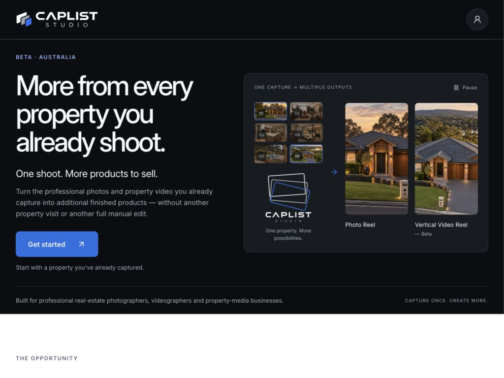
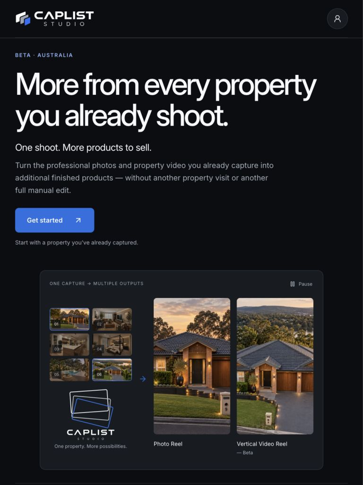
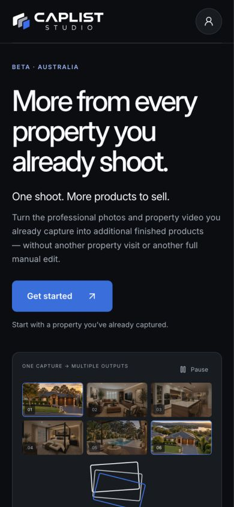
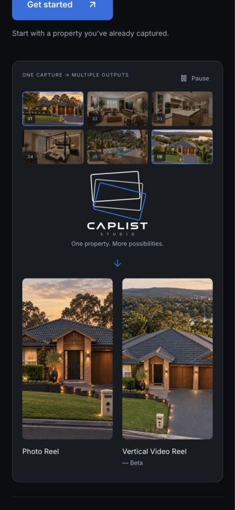
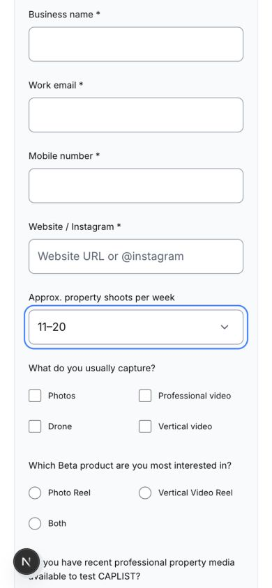
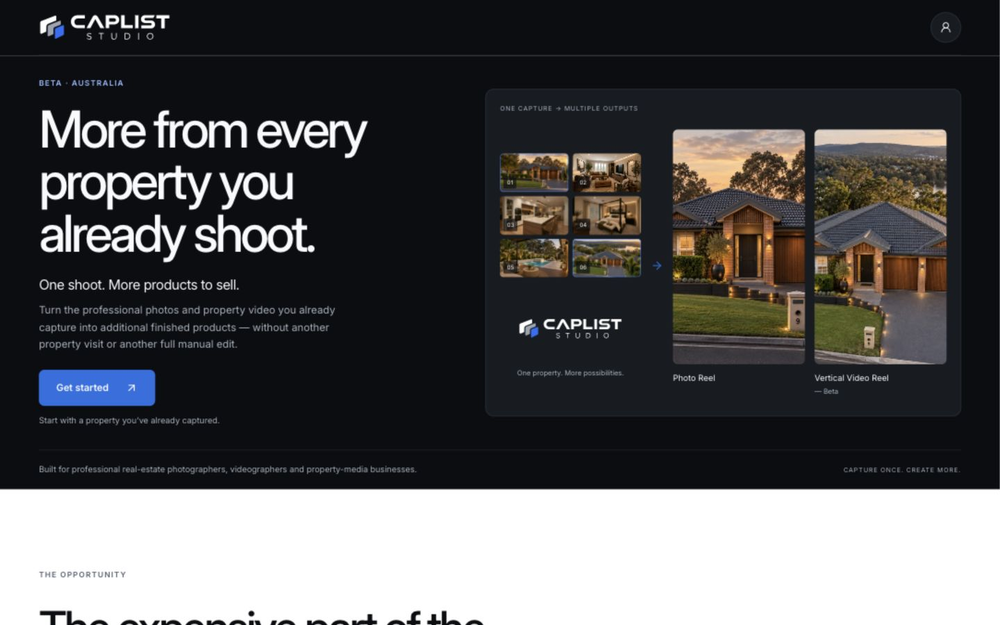

# Founding Beta hero balance review

16 October 2026 — `feature/mvp-founding-beta-landing`

## Changes in this pass

- One bordered graphite composition contains the compact source catalogue, canonical CAPLIST motion identity and two prominent finished-format previews.
- Desktop/tablet place the catalogue and compact identity beside the outputs. Mobile follows source → identity → outputs vertically.
- Source images remain 16:9. Outputs are 9:16, share a baseline and have directly attached labels. Source selection and output emphasis use restrained opacity changes without moving layout boxes.
- Header/hero padding and copy spacing are tighter; headline typography is unchanged. The motion identity still reuses `BetaMotionLogo` → `CaplistMotionLogo` and the approved `caplist-logo-motion-dark-transparent-short-2s-web.svg` asset, with the existing two-second motion and six-second hold.
- The native shoot-volume select has 52px right padding and a decorative caret inset 18px, vertically centred. Native selection, keyboard navigation, focus outline and label association remain intact. Forced-colour mode restores the native caret.

Implementation files changed in this pass:

- `app/founding-beta/page.tsx`
- `app/founding-beta/founding-beta.module.css`
- `components/founding-beta/BetaApplication.tsx`

Earlier uncommitted work is preserved. No form transport or canonical motion-asset changes in this pass.

## Viewport review

| Viewport | Observation |
| --- | --- |
| 1440 × 900 | CTA bottom 584px; full hero ends at 704px. Catalogue thumbnails approximately 98 × 55px; output previews approximately 190 × 338px. |
| 1024 × 768 | CTA bottom 522px; full hero ends at 638px. Output previews approximately 128 × 227px, with shared baseline within subpixel rounding. |
| 768 × 1024 | CTA bottom 491px. Copy stacks above the visual; the visual retains its integrated horizontal arrangement. |
| 390 × 844 | CTA bottom 519px. Visual follows vertically below; output previews remain larger than source thumbnails. |

No horizontal overflow at any reviewed width. Hero stage, catalogue, identity and output bounding boxes were identical in two observations across the animation cycle. Pause changed the running state to false and CSS animation state to paused; Play resumed it.

Keyboard check: Space → ArrowDown → Enter changed the select from 6–10 to 11–20. The focused native control retained its 2px CAPLIST Blue outline. Measured caret inset: 18px; vertical-centre difference: 0px.

Reduced-motion branch was checked in the production export with a local test-only `matchMedia` override: resolved `caplist-horizontal-on-dark.svg`, no timed SVG object and no output animation. This was a preference-branch simulation, not an OS preference change.

## Validation

- `npm run lint` — passed.
- `npm run typecheck` — passed.
- `npm run build` — passed; 25 static pages generated.
- `python3 scripts/check-marketing-copy.py` — passed copy and internal-link checks.
- `node scripts/check-beta-crop.mjs` — passed exact crop geometry and cover-fit checks.
- `git diff --check` — passed.

Non-blocking existing warnings: parent-directory yarn.lock ignored by Next; Node reparses the crop helper as an ES module.

## Screenshots

The desktop/tablet/mobile captures use the local production export. The select capture uses the development preview. No commit, push, merge or deployment was performed.
