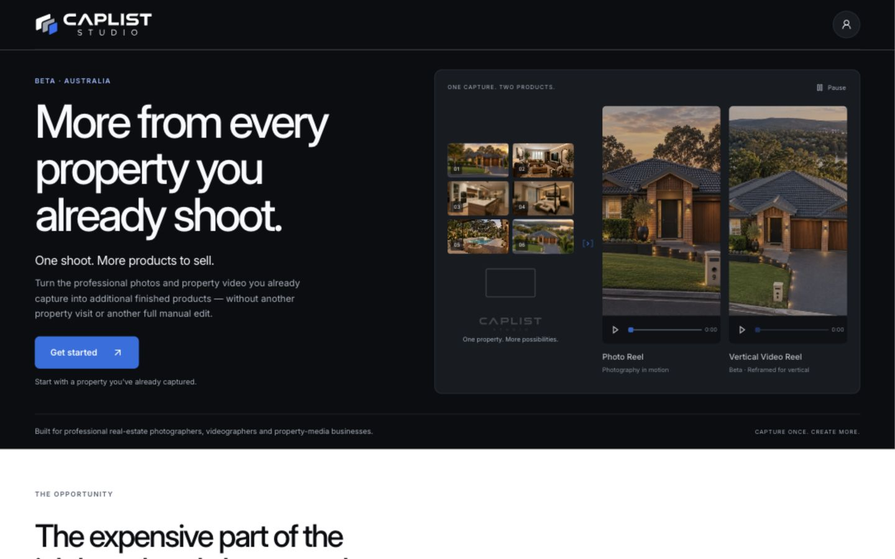
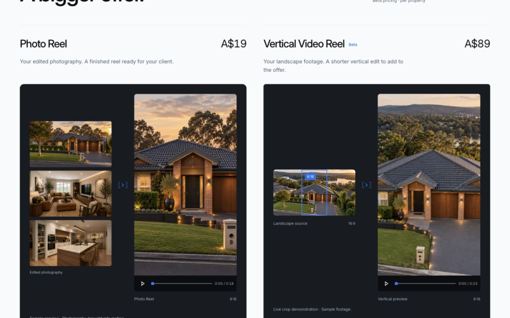
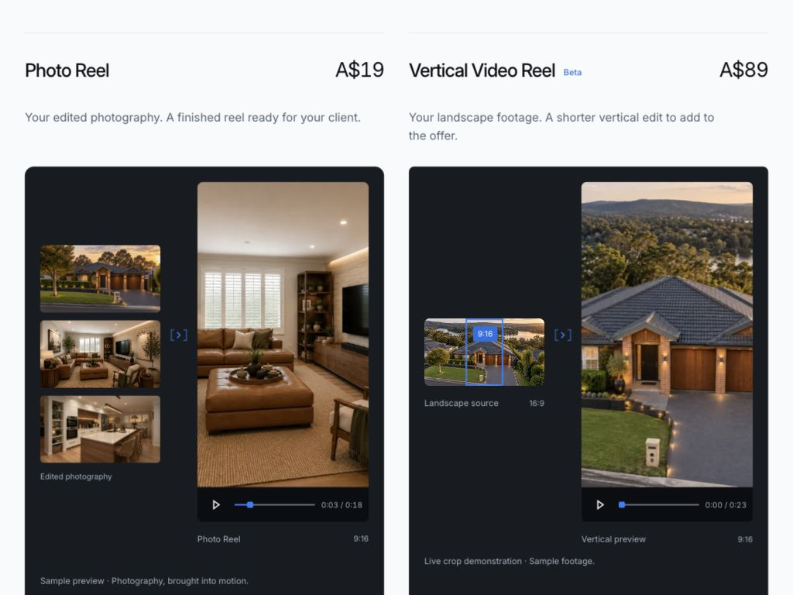
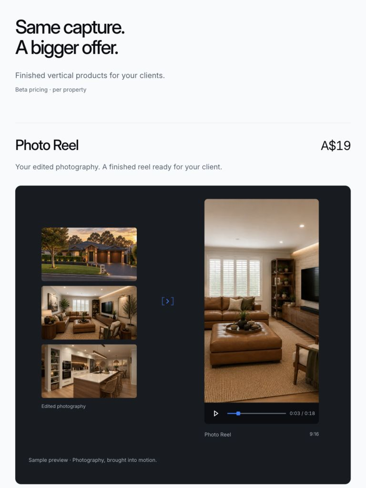
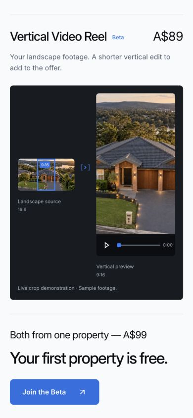
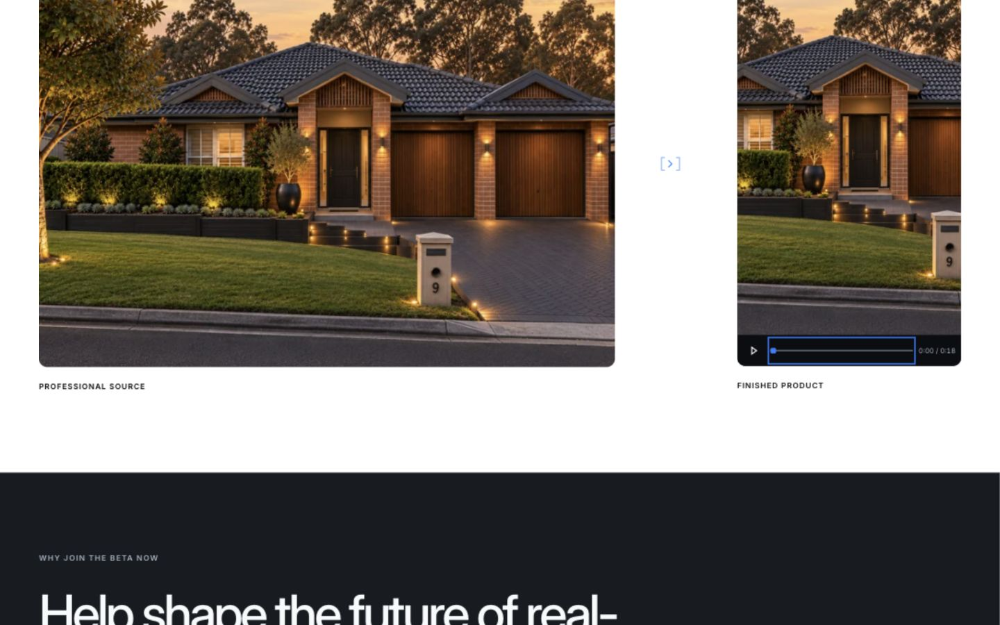

# Founding Beta — inline controls and connectors

16 October 2026. Branch: `feature/mvp-founding-beta-landing`.

## Refinement

Removed every floating Play pill. Five media previews now share `MediaControls`: both hero outputs, the main Photo Reel, the live crop output, and Professional Standard.

The control rail is part of the media component, directly below its unchanged 9:16 frame. It uses CAPLIST Black against the graphite surface, a compact outlined Play/Pause icon, a thin CAPLIST Blue progress track, a small squared scrubber, and tabular time. Narrow rails show elapsed time; wider rails show elapsed/total. Accessible slider value text includes both at every size. Buttons and sliders retain keyboard interaction and visible focus states.

Photo previews now have a real 18-second timeline with seeking across six stable image dissolves. Video controls follow native playback time and seeking. Playback pauses offscreen or in a hidden tab. The crop preview retains its existing exact canvas mapping and shows the poster at the initial paused position, avoiding a black first decoded frame when metadata preloads.

Nine directional connectors reuse the revised `FlowArrow`: open-frame terminals with an inset directional mark, inspired by CAPLIST's frame motif. The 1.5px non-scaling strokes match the playback icon weight. No floating button, circular badge or animated connector was added. Existing CTA link icons are unchanged.

Approved copy, pricing, typography, colours, form and page structure remain unchanged. Media frames retain their ratios; the inline rails add 44px underneath. The Professional Standard wrapper allows the rail to remain visible rather than clipping it.

## Files changed in this pass

- `components/founding-beta/MediaControls.tsx` — new shared controls.
- `components/founding-beta/MediaControls.module.css` — rail, scrubber, responsive time display and interaction states.
- `components/founding-beta/ReelPreview.tsx`
- `components/founding-beta/ReelPreview.module.css`
- `components/founding-beta/LiveCropPreview.tsx`
- `components/founding-beta/LiveCropPreview.module.css`
- `components/founding-beta/FlowArrow.tsx`
- `app/founding-beta/founding-beta.module.css`

Earlier uncommitted changes remain intact. No commit, push, merge or deployment.

## Validation

- Lint, typecheck and production build passed; 25 static pages generated.
- Exact crop geometry checks passed.
- Approved copy and internal-link checks passed.
- `git diff --check` passed.
- Production preview audited at 1440, 1024, 768 and 390px: no horizontal overflow.
- All five control rails fit without internal overflow at 1024 and 390px, including the 128px-wide laptop hero rails.
- Laptop CTA remains above the fold: bottom at 522px in a 1024 × 768 viewport.
- Photo timeline End selects the final image at 18 seconds; Home restores the first. Play advances progress; Pause stops it.
- Crop video playback advances through the 23.4-second source. Pause and keyboard Home work; the poster returns at the start.
- Professional Standard playback, pause and keyboard seeking verified.
- DOM audit: five shared rails, nine shared connectors, zero old floating playback buttons.
- Reduced-motion preference branch checked using the local test-only `matchMedia` override: resolved logo, paused video defaults and controls available. This did not change the OS preference. Existing reduced-motion CSS disables dissolves.

Existing non-blocking warnings: Next ignores a parent yarn.lock; Node reparses the crop helper as an ES module.

## Viewport captures

1440 desktop keeps controls attached and both preview baselines aligned. 1024 retains the two-product layout and above-fold hero CTA. 768 stacks the offers with full inline controls. 390 uses the compact elapsed-time display while keeping the scrubber usable.

