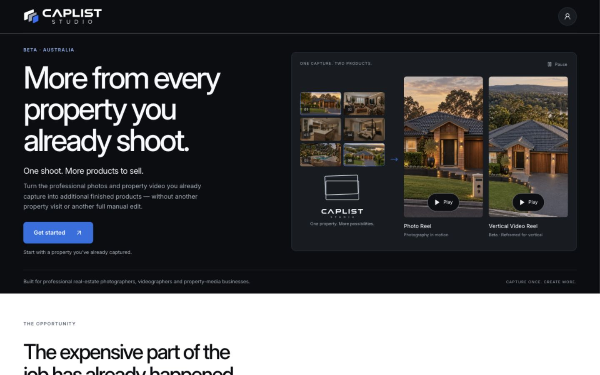
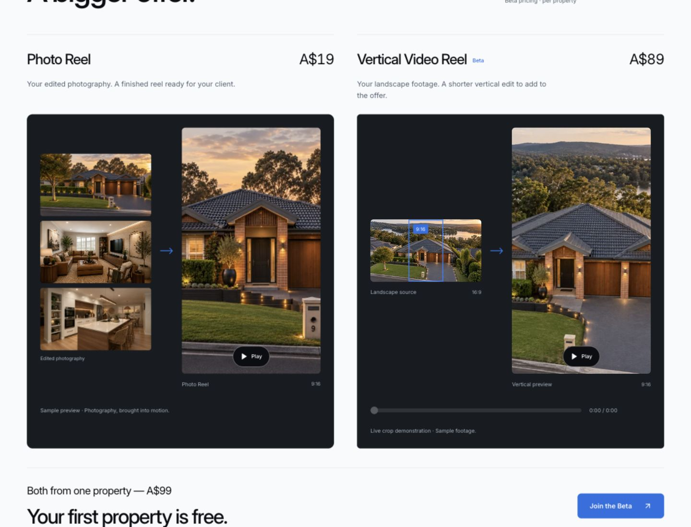
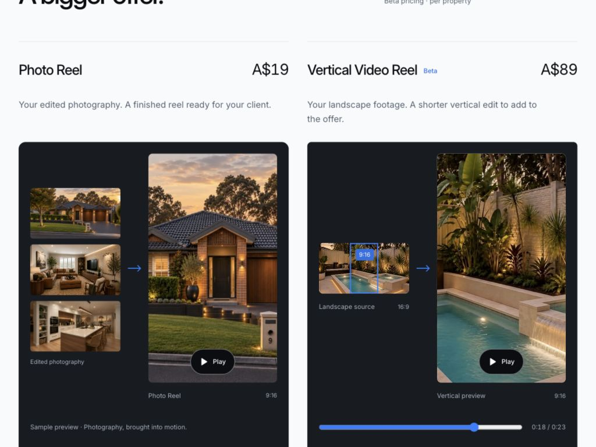
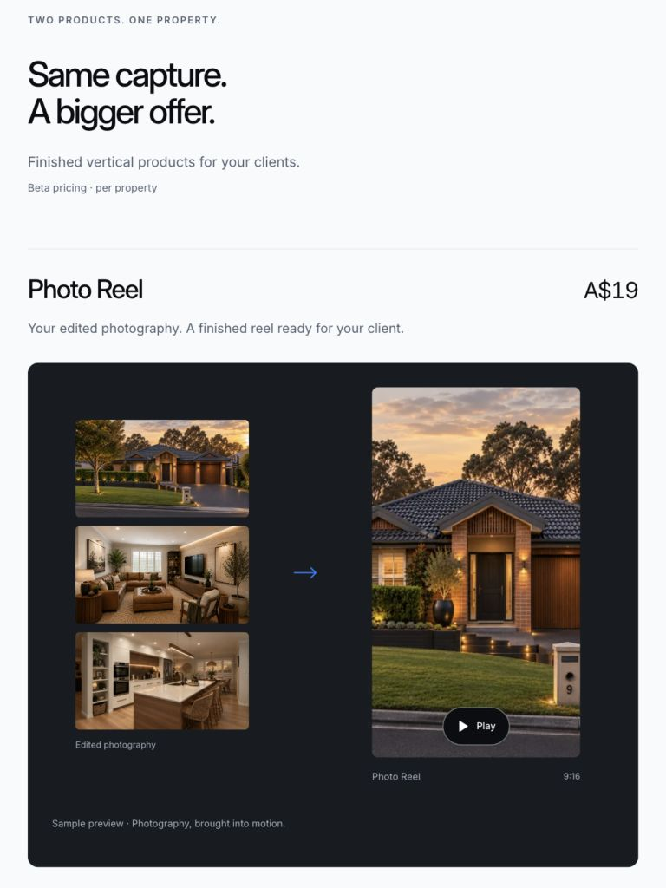
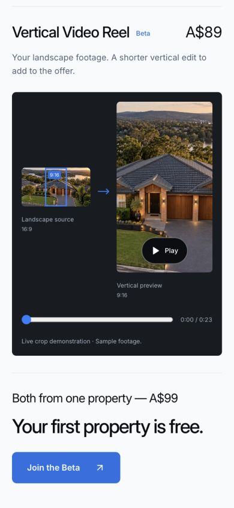
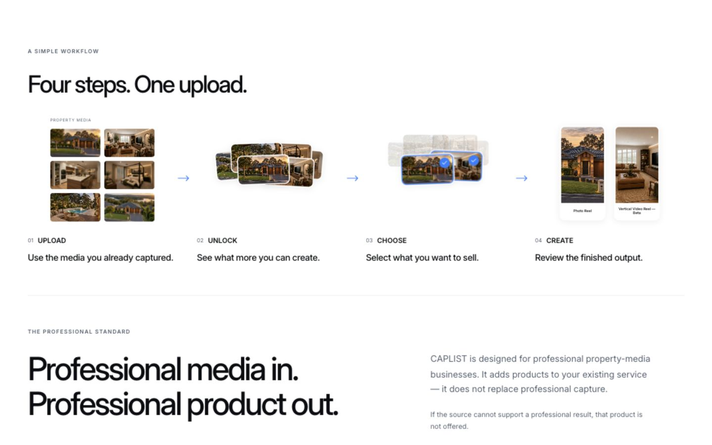
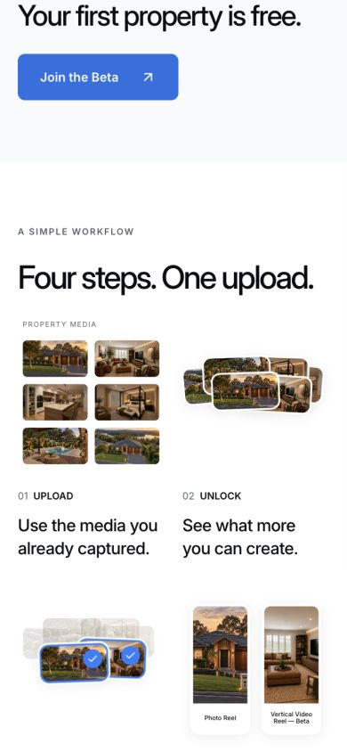
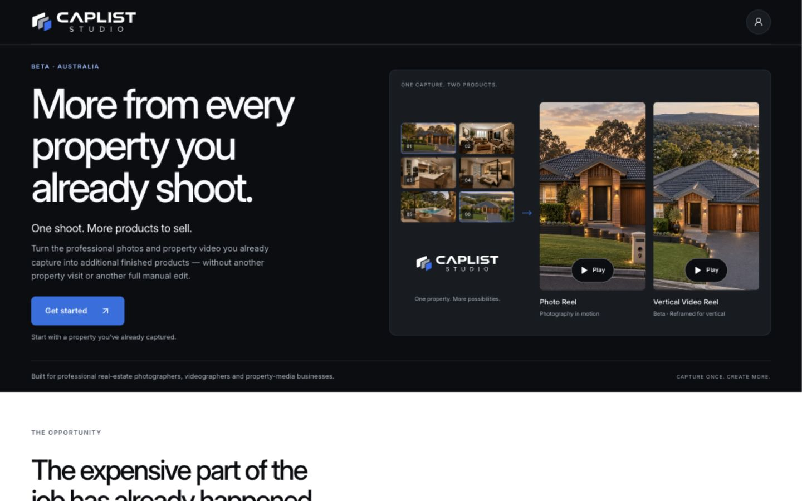

# Founding Beta — product-led refinement

16 October 2026. Branch: `feature/mvp-founding-beta-landing`.

## Product clarity

The hero now presents two playable product-format previews with attached names and short descriptors. The Photo Reel uses stable dissolves between existing property photographs; the Vertical Video Reel uses the existing property footage. The approved CAPLIST motion identity is unchanged.

“Two products. One property.” is the primary offer. Each product has its own name, attached price, concise value statement and graphite preview surface. Finished-format previews are larger than the supporting source media. Both offers share the same layout, preview baseline and panel height on desktop/laptop. Tablet and mobile stack the offers while retaining a source-to-output layout within each preview.

The existing live crop remains an exact 16:9 → 9:16 mapping: both canvases use one decoded frame and the existing crop geometry. Its Play/Pause control now sits directly on the vertical output. The seek control remains keyboard accessible.

Preview controls use a contrasting graphite pill, white icon/text, CAPLIST Blue hover state and visible keyboard focus. Every Play control in these product previews is functional. Samples remain identified as previews/demonstrations; this pass does not add new production footage.

The opportunity section is shorter and the workflow is more compact, with the heading “Four steps. One upload.” Its approved stage titles remain. Decorative play icons were removed from the Beta workflow illustrations to distinguish them from playable previews. Professional Standard reuses the stable Photo Reel preview instead of the native player.

All source/process/output connectors now share `FlowArrow`: an angular line arrow with a consistent 1.5px stroke. The Founding Beta workflow uses the same geometry and fixed CAPLIST Blue, without its previous colour animation. Other marketing routes retain their existing workflow arrows.

Final CTA heading: **See what more your properties could become.**

## Pricing consolidation

Removed the later duplicate Beta pricing section. A$19 and A$89 each appear once, beside their product names. A$99 appears once in the shared bundle statement. “Your first property is free.” is the prominent benefit directly below, alongside Join the Beta.

The signup fields and transport are unchanged in this pass.

## Files changed in this pass

- `app/founding-beta/page.tsx`
- `app/founding-beta/founding-beta.module.css`
- `components/founding-beta/FlowArrow.tsx` — new shared directional geometry.
- `components/founding-beta/ReelPreview.tsx` — new user-controlled previews with offscreen/background pause and reduced-motion support.
- `components/founding-beta/ReelPreview.module.css`
- `components/founding-beta/LiveCropPreview.tsx`
- `components/founding-beta/LiveCropPreview.module.css`
- `components/how-it-works/WorkflowStory.tsx` — changes gated to the Founding Beta variant.
- `components/how-it-works/WorkflowStory.module.css` — Beta-only arrow treatment.

Earlier uncommitted changes were preserved. Canonical motion assets were not edited. No commit, push, merge or deployment.

## Validation

- `npm run lint` — passed.
- `npm run typecheck` — passed.
- `npm run build` — passed; 25 static pages generated.
- `node scripts/check-beta-crop.mjs` — exact crop geometry, source/poster cover fit and invalid-dimension checks passed.
- `python3 scripts/check-marketing-copy.py` — approved copy and internal links/anchors passed.
- `git diff --check` — passed.

Existing non-blocking warnings: Next ignores the parent directory's yarn.lock; Node reparses the crop helper as an ES module.

Browser validation used the production export on localhost:

| Width | Findings |
| --- | --- |
| 1440 | Two aligned product offers; product names, prices, previews and bundle form one section. No horizontal overflow. Hero checked at 900px height; the complete offer capture uses 1100px height. |
| 1024 | Two aligned preview panels, both 464px wide and 561px high. CTA bottom 522px; hero bottom 638px in a 768px viewport. No horizontal overflow. |
| 768 | Offers stack; each preview retains the internal source/output arrangement. Product names and prices remain attached. No horizontal overflow. |
| 390 | Product name/price, preview, bundle and free-property benefit remain legible. Workflow becomes a compact two-column sequence. No horizontal overflow. |

Playback checks:

- Hero video starts on Play and pauses when scrolled offscreen.
- Main Photo Reel advances from the exterior to other property images. Frame bounds remained identical across playback: 288.89 × 513.58px at the same position.
- Live crop played the existing 23.4-second source, with advancing current time, matching source/output frames and working Pause.
- Keyboard Home on the crop seek slider returned playback to 0 while paused.
- Workflow arrows were verified as CAPLIST Blue, 1.5px stroke, with no colour animation.
- Reduced-motion preference branch was simulated using a test-only local `matchMedia` override. The resolved CAPLIST lockup appeared, timed logo was absent, videos stayed paused, and photos started on their static first frame. This did not change the OS preference; actual reduced-motion CSS also disables photo dissolves.

## Screenshots

